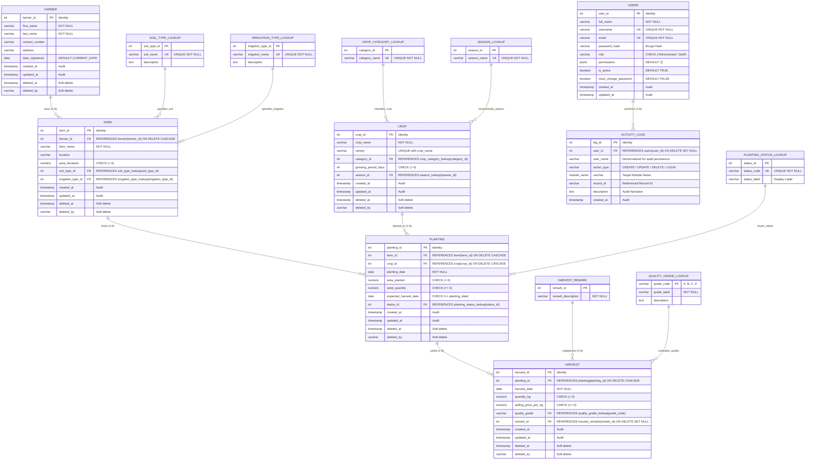

# APAgri Entity-Relationship Diagram (ERD) & Database Architecture
**System:** APAgri Web-Based Agriculture Information System  
**Course & Project:** CTU AP3 Midterm Project  
**Database Engine:** PostgreSQL 15+ (Supabase)  
**Standard:** Third Normal Form (3NF), Referential Integrity, Auditability & Soft-Delete Preservation  

---

## 1. Mermaid.js Entity-Relationship Diagram



---

## 2. DBML Code (Database Markup Language for dbdiagram.io)

Copy and paste the code block below into [dbdiagram.io](https://dbdiagram.io/) to generate high-resolution PNG, PDF, or SVG diagrams:

```dbml
// =============================================================================
// APAgri — Agriculture Information System DBML
// Compatible with dbdiagram.io
// =============================================================================

Table farmer {
  farmer_id int [pk, increment]
  first_name varchar(50) [not null]
  last_name varchar(50) [not null]
  contact_number varchar(20)
  address varchar(150)
  date_registered date [default: `CURRENT_DATE`]
  created_at timestamp [not null, default: `CURRENT_TIMESTAMP`]
  updated_at timestamp [not null, default: `CURRENT_TIMESTAMP`]
  deleted_at timestamp
  deleted_by varchar(100)
}

Table farm {
  farm_id int [pk, increment]
  farmer_id int [not null, ref: > farmer.farmer_id]
  farm_name varchar(100) [not null]
  location varchar(150)
  area_hectares numeric(8,2) [not null, note: 'CHECK area_hectares > 0']
  soil_type_id int [not null, ref: > soil_type_lookup.soil_type_id]
  irrigation_type_id int [ref: > irrigation_type_lookup.irrigation_type_id]
  created_at timestamp [not null, default: `CURRENT_TIMESTAMP`]
  updated_at timestamp [not null, default: `CURRENT_TIMESTAMP`]
  deleted_at timestamp
  deleted_by varchar(100)
}

Table crop {
  crop_id int [pk, increment]
  crop_name varchar(80) [not null]
  variety varchar(80)
  category_id int [not null, ref: > crop_category_lookup.category_id]
  growing_period_days int [not null, note: 'CHECK growing_period_days > 0']
  season_id int [ref: > season_lookup.season_id]
  created_at timestamp [not null, default: `CURRENT_TIMESTAMP`]
  updated_at timestamp [not null, default: `CURRENT_TIMESTAMP`]
  deleted_at timestamp
  deleted_by varchar(100)

  indexes {
    (crop_name, variety) [unique]
  }
}

Table planting {
  planting_id int [pk, increment]
  farm_id int [not null, ref: > farm.farm_id]
  crop_id int [not null, ref: > crop.crop_id]
  planting_date date [not null]
  area_planted numeric(8,2) [not null, note: 'CHECK area_planted > 0']
  seed_quantity numeric(8,2) [not null, default: 0, note: 'CHECK seed_quantity >= 0']
  expected_harvest_date date [note: 'CHECK expected_harvest_date >= planting_date']
  status_id int [not null, default: 1, ref: > planting_status_lookup.status_id]
  created_at timestamp [not null, default: `CURRENT_TIMESTAMP`]
  updated_at timestamp [not null, default: `CURRENT_TIMESTAMP`]
  deleted_at timestamp
  deleted_by varchar(100)
}

Table harvest {
  harvest_id int [pk, increment]
  planting_id int [not null, ref: > planting.planting_id]
  harvest_date date [not null]
  quantity_kg numeric(10,2) [not null, note: 'CHECK quantity_kg > 0']
  selling_price_per_kg numeric(10,2) [note: 'CHECK selling_price_per_kg >= 0']
  quality_grade varchar(10) [ref: > quality_grade_lookup.grade_code]
  remark_id int [ref: > harvest_remark.remark_id]
  created_at timestamp [not null, default: `CURRENT_TIMESTAMP`]
  updated_at timestamp [not null, default: `CURRENT_TIMESTAMP`]
  deleted_at timestamp
  deleted_by varchar(100)
}

Table harvest_remark {
  remark_id int [pk]
  remark_description varchar(80) [not null]
}

Table users {
  user_id int [pk, increment]
  full_name varchar(120) [not null]
  username varchar(80) [unique, not null]
  email varchar(255) [unique, not null]
  password_hash varchar(255) [not null]
  role varchar(20) [not null, note: 'Administrator | Staff']
  permissions jsonb [not null, default: '{}']
  is_active boolean [not null, default: true]
  must_change_password boolean [not null, default: false]
  created_at timestamp [not null, default: `CURRENT_TIMESTAMP`]
  updated_at timestamp [not null, default: `CURRENT_TIMESTAMP`]
}

Table activity_logs {
  log_id int [pk, increment]
  user_id int [ref: > users.user_id]
  user_name varchar(120) [not null]
  action_type varchar(40) [not null]
  module_name varchar(80) [not null]
  record_id varchar(80)
  description text [not null]
  created_at timestamp [not null, default: `CURRENT_TIMESTAMP`]
}

Table soil_type_lookup {
  soil_type_id int [pk, increment]
  soil_name varchar(50) [unique, not null]
  description text
}

Table irrigation_type_lookup {
  irrigation_type_id int [pk, increment]
  irrigation_name varchar(50) [unique, not null]
  description text
}

Table crop_category_lookup {
  category_id int [pk, increment]
  category_name varchar(50) [unique, not null]
}

Table season_lookup {
  season_id int [pk, increment]
  season_name varchar(50) [unique, not null]
}

Table planting_status_lookup {
  status_id int [pk, increment]
  status_code varchar(30) [unique, not null]
  status_label varchar(50) [not null]
}

Table quality_grade_lookup {
  grade_code varchar(10) [pk]
  grade_label varchar(50) [not null]
  description text
}
```

---

## 3. Relational Cardinalities & Business Rules Summary

| Relationship | Cardinality | Parent Entity | Child Entity | Foreign Key | Cascade Rule |
| :--- | :---: | :--- | :--- | :--- | :--- |
| **Farmer to Farm** | `1 : N` | `farmer` | `farm` | `farm.farmer_id` | `ON DELETE CASCADE` |
| **Farm to Planting** | `1 : N` | `farm` | `planting` | `planting.farm_id` | `ON DELETE CASCADE` |
| **Crop to Planting** | `1 : N` | `crop` | `planting` | `planting.crop_id` | `ON DELETE CASCADE` |
| **Planting to Harvest** | `1 : N` | `planting` | `harvest` | `harvest.planting_id` | `ON DELETE CASCADE` |
| **Remark to Harvest** | `1 : N` | `harvest_remark` | `harvest` | `harvest.remark_id` | `ON DELETE SET NULL` |
| **User to Activity Log**| `1 : N` | `users` | `activity_logs`| `activity_logs.user_id`| `ON DELETE SET NULL`|
| **Soil to Farm** | `1 : N` | `soil_type_lookup`| `farm` | `farm.soil_type_id` | `ON DELETE RESTRICT` |
| **Irrigation to Farm** | `1 : N` | `irrigation_type_lookup` | `farm` | `farm.irrigation_type_id` | `ON DELETE SET NULL` |
| **Category to Crop** | `1 : N` | `crop_category_lookup` | `crop` | `crop.category_id` | `ON DELETE RESTRICT` |
| **Season to Crop** | `1 : N` | `season_lookup` | `crop` | `crop.season_id` | `ON DELETE SET NULL` |
| **Status to Planting** | `1 : N` | `planting_status_lookup`| `planting` | `planting.status_id` | `ON DELETE RESTRICT` |
| **Grade to Harvest** | `1 : N` | `quality_grade_lookup` | `harvest` | `harvest.quality_grade` | `ON DELETE SET NULL` |

### Soft-Delete & Child Preservation Rule
In the application layer (`archive.php`), soft-deletion is enforced via `deleted_at IS NULL`. A parent record cannot be archived if it has active child records (e.g., a `farmer` with active `farm` records, or a `farm` with active `planting` records). Restoring a child requires that the parent record has already been restored.
